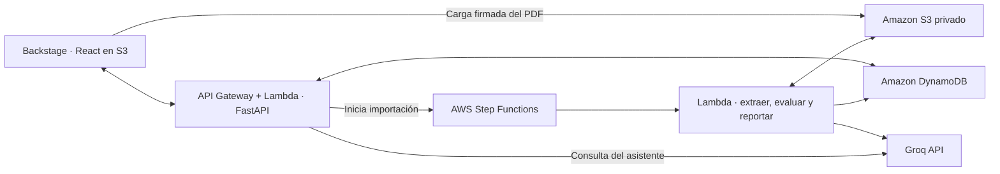

# TicketPass Studio

**Proyecto final de Cloud Computing · UTEC Posgrado**

TicketPass Studio ayuda a organizadores a convertir la ficha o el contrato de un evento en un borrador listo para revisar. El organizador adjunta un PDF, contrasta los datos con sus páginas de origen y confirma qué se publica en el catálogo.

[Aplicación de demostración](http://ticketpass-studio-dev-frontendbucket-e0ol2hcafio7.s3-website-us-east-1.amazonaws.com/) · [Despliegue en AWS](docs/DESPLIEGUE.md) · [Pruebas y verificación](docs/VERIFICACION.md) · [Colección Postman](docs/TicketPass.postman_collection.json)

## Cómo funciona

1. **Crear.** Abre Backstage y guarda un borrador del evento.
2. **Adjuntar.** Carga un PDF con texto seleccionable desde el asistente. El análisis devuelve campos candidatos con citas y páginas.
3. **Revisar.** Consulta los datos en el chat, elige las propuestas correctas y completa los campos que falten.
4. **Publicar.** Confirma la ficha para que aparezca en el catálogo. Desde **Importaciones** puedes consultar el análisis y descargar su CSV.

En **Mis eventos** puedes eliminar los borradores de prueba o retirar un evento del catálogo para editarlo y volver a publicarlo. Al retirarlo, su ficha y sus importaciones se conservan. Al eliminar un borrador, el evento y sus importaciones dejan de estar disponibles en Backstage.

Para probar la revisión, usa **Probar un PDF de ejemplo** en el asistente: el [documento de muestra](backend/assets/evento-ejemplo.pdf) contiene dos fechas. El [contrato ficticio](backend/assets/contrato-ejemplo.pdf) sirve para consultar condiciones y distinguir honorarios de precios de entrada.

El MVP procesa un PDF por carga, de hasta **5 MB, 5 páginas y 18.000 caracteres**. El asistente consulta la ficha guardada y hasta tres importaciones recientes del evento. Groq procesa cada consulta sin recibir el historial de mensajes. La extracción requiere texto seleccionable. OCR, pagos y predicción de demanda quedan fuera del alcance.

## Arquitectura

El workflow de nivel 4 usa **AWS Step Functions Standard** para coordinar la extracción, la evaluación con Groq y la generación del reporte.



DynamoDB guarda fichas, estados de importación y registros de acceso. Los PDF y los reportes quedan en S3 privado. El backend valida el propietario, verifica las citas contra sus páginas y comprueba la versión del borrador antes de guardar cambios. El chat redacta respuestas a partir de la ficha y las fuentes verificadas. El organizador aplica las propuestas y confirma la publicación desde la interfaz.

## Ejecutar en local

Requisitos: **Python 3.12+** y **Node.js 20.19+ o 22.12+**. Estos comandos usan PowerShell desde la raíz del repositorio.

```powershell
python -m venv .venv
.\.venv\Scripts\python.exe -m pip install -r backend/requirements.txt
npm --prefix frontend ci
```

En una terminal, inicia la API:

```powershell
Set-Location backend
..\.venv\Scripts\python.exe -m uvicorn api:app --host 127.0.0.1 --port 8000
```

En otra terminal, desde la raíz, inicia la web:

```powershell
npm --prefix frontend run dev
```

Abre [Backstage](http://127.0.0.1:5173/) y crea una cuenta de prueba. La [documentación interactiva de la API](http://127.0.0.1:8000/docs) está disponible mientras el backend esté en ejecución. En local se usa SQLite y los archivos se guardan bajo `.local/`.

Para activar Groq, copia [`.env.example`](.env.example) a `.env` en la raíz, configura `GROQ_API_KEY` y reinicia el backend. El modelo predeterminado es `openai/gpt-oss-120b`. Sin clave, el modo local permite probar el formulario y la extracción básica de campos con etiquetas. El análisis con IA y las consultas documentales requieren Groq.

## Entrega y verificación

| Material | Qué contiene |
| --- | --- |
| [Guía de AWS Academy](docs/AWS.md) | Empaquetado y despliegue con Serverless Framework. |
| [Evidencia del despliegue](docs/DESPLIEGUE.md) | Región, endpoints y comprobaciones registradas en AWS. |
| [Verificación](docs/VERIFICACION.md) | Pruebas del flujo, el chat y los controles de acceso. |
| [Colección Postman](docs/TicketPass.postman_collection.json) | Solicitudes para probar las rutas del MVP. |

La prueba en AWS Academy completó la carga, el análisis, la publicación y la descarga del CSV. La disponibilidad de la demo depende del laboratorio. El sitio estático de la demo usa HTTP y la API usa HTTPS.

Para correr las pruebas y compilar la web:

```powershell
.\.venv\Scripts\python.exe -m pip install -r backend/requirements-dev.txt
Push-Location backend
..\.venv\Scripts\python.exe -m pytest tests -q
Pop-Location
npm --prefix frontend run build
```
